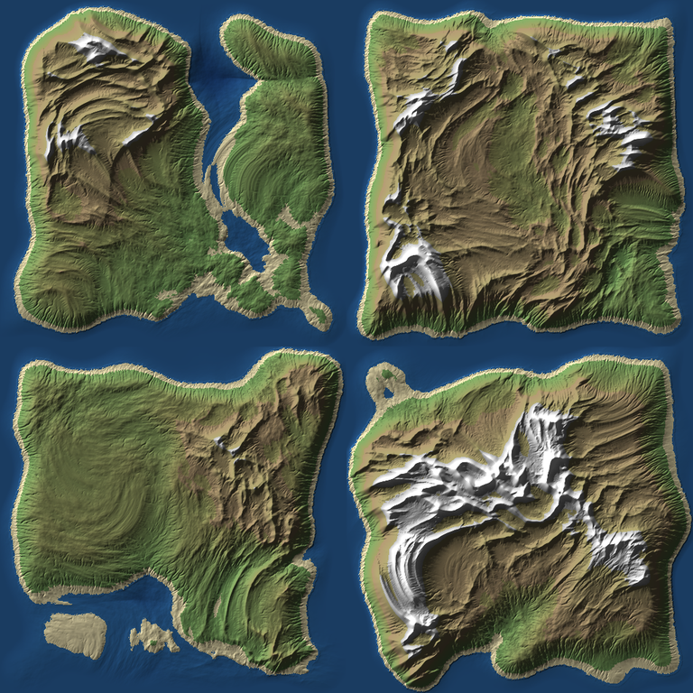
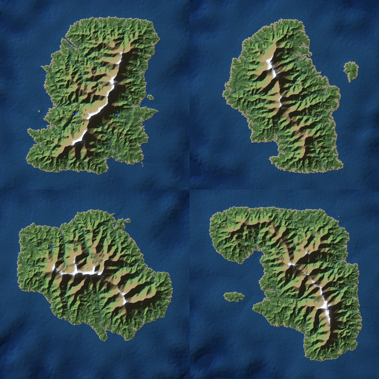

# Địa hình Zion: địa chất và thủy văn (World Studio → trận đấu)

Tài liệu này mô tả hệ thống sinh địa hình mới của World Studio (Terrain Studio), lý do thay thế phương pháp cũ, và cách nước (sông, hồ) đi từ Studio vào trận đấu thực tế.

## 1. Phương pháp cũ và vì sao địa hình trông giả

| Module cũ | Vấn đề |
| --- | --- |
| `editor/terrain-gen.ts` `reliefAt` + `Plates` | Độ cao = noise fbm/ridged + "mảng kiến tạo" Voronoi. Núi là các dải ridged-noise dọc biên mảng, không có hệ sống núi, nhánh núi, thung lũng nối nhau; phần lõm giữa các dải ridged noise tạo hình "khoét bằng thìa". |
| Mặt nạ đảo (`seaEdge`) | Một công thức cố định: khoảng cách tới mép bản đồ (soft-min) + một chút noise. Mọi đảo đều là hình vuông bo góc với viền răng cưa; bán đảo, vịnh chỉ là noise. |
| Xói mòn | Chỉ có giọt nước (droplet) chạy trên bề mặt noise: khắc rãnh nhỏ nhưng không tạo được lưu vực; ~3 000–4 700 hố trũng kín trên đất liền mỗi bản đồ 4 km (nước không có lối thoát). |
| Sông (`auto-map.ts`) | Đi xuống dốc theo 16 hướng từ một điểm cao ngẫu nhiên, bị kẹt ở hố thì bỏ; không có lưu vực, phụ lưu, hợp lưu. |
| Hồ (`auto-map.ts`) | Một đa giác ngẫu nhiên 10 đỉnh đặt lên chỗ tương đối bằng, rồi đào. |
| Xuất bản (`battle-export.ts`) | **Không xuất sông hồ.** `toBattleMap` chỉ gửi lưới độ cao; `WorldGenerator.sampleColumn` ở chế độ battle royale đặt `water = NaN`. Vì vậy Studio có sông hồ nhưng trận đấu không có nước. |
| Đặt tên địa điểm | Ghép ngẫu nhiên hai từ trong danh sách 16 từ ("Thành phố Bắc Hồng"), không liên quan địa hình. |
| Xe battle royale | Chỉ đỗ ở lề đường gần khu dân cư: bản đồ ít đường/không có khu dân cư thì gần như không có xe. |
| Mưa | Hạt mưa là point sprite: vệt dài cố định theo pixel, không dài theo vận tốc, không nghiêng theo gió hay theo chuyển động camera; tốc độ chỉ 9–13 m/s và ở mưa nhỏ chỉ còn các hạt chậm (tốc độ gắn với thứ tự mật độ); vào nhà là tắt mưa đột ngột. |

## 2. Phương pháp mới

### 2.1 Hình dạng đảo (`editor/landform.ts`, bước 1)

- **Bộ khung**: một xương sống chính (polyline đi ngẫu nhiên, có độ rộng thay đổi), 0–4 nhánh (bán đảo) và vài đảo nhỏ ngoài khơi, tất cả theo seed.
- Đất liền = vùng gần khung, bờ bị bẻ cong bằng **domain warping** hai tầng và noise nhiều tỷ lệ → vịnh, mũi đất, bán đảo, cửa sông tự nhiên.
- Tỷ lệ đất theo preset chỉ dịch bờ vào/ra một chút; mép bản đồ chỉ ép biển ở rìa ngoài cùng, nên hình đảo không còn là hình vuông.
- Khoảng cách tới bờ (chamfer distance) quyết định thềm lục địa: độ dốc thềm thay đổi dọc bờ → bãi cát thoải ở chỗ thềm thoải, vách đá ở chỗ dãy núi chạm biển.

### 2.2 Cấu trúc địa chất (bước 2–3)

- **Dãy núi = đường sống núi**: sống chính lệch về một phía bờ (hoặc hai dãy song song kẹp thung lũng ở preset Thung lũng), có **nhánh núi và nhánh phụ** rẽ ra hai bên; độ cao đỉnh thay đổi dọc sống.
- **Nâng kiến tạo (uplift)** = sống núi + nâng nền vào trong đảo + đồi thấp; **vùng đồng bằng/vùng trũng** (lowland basins) xa dãy núi hầu như không được nâng.
- **Xói mòn dòng chảy (stream-power, E = K·A^m·S)** giải trên lưới thô 257² bằng sơ đồ ẩn O(n) của Braun & Willett (2013), cây thoát nước lấy từ Priority-Flood+ε (Barnes và cộng sự 2014), giới hạn sườn theo góc nghỉ. Thung lũng, khe núi, sống núi, đèo và mặt cắt dọc sông lõm đều *tự sinh ra* từ mô phỏng, không vẽ tay và không phải noise.
- Ở lưới đầy đủ: nội suy bicubic qua một lớp warp nhẹ (không còn mặt phẳng theo trục lưới), **cao nguyên** (ép phẳng phần trên một mức, thung lũng bên dưới thành hẻm), **đá phân lớp** trên vách dốc cao, và noise chi tiết theo độ cao/độ dốc (≈1 m ở đồng bằng, đá lởm chởm trên núi). Noise chỉ còn vai trò chi tiết.
- Sau đó xói mòn giọt nước (Beyer 2015, đã có sẵn) và xói mòn nhiệt (vòng lặp đã tối ưu, nhanh hơn 15 lần, kết quả giống hệt).

### 2.3 Thủy văn (`editor/hydro.ts`)

1. Priority-Flood+ε từ biển và mép bản đồ: thứ tự nước tới mỗi ô, mức tràn của mỗi bồn kín, lối thoát cho mọi hố và mặt phẳng.
2. **Hồ** ở các bồn đủ sâu (≥1,5 m) và rộng, mặt nước ở mức tràn; bờ hồ lấy bằng marching squares đúng đường đồng mức. Bồn còn lại được lấp (phù sa) → không còn hố trũng khô. Thiếu hồ so với yêu cầu thì đào bồn ở đáy thung lũng bằng nhất, đủ sâu để khép kín dưới vành thấp nhất.
3. Hướng dòng chảy D8 trên bề mặt đã lấp, **tích lũy dòng chảy** có trọng số mưa (mưa nhiều hơn trên núi) → lưu vực/đường phân thủy là các cây thoát nước.
4. **Sông** ở nơi diện tích lưu vực vượt ngưỡng; truy từ cửa sông ngược lên theo nhánh dài nhất (dòng chính), phụ lưu nhập vào ở chỗ hợp lưu; độ rộng/độ sâu tăng theo diện tích lưu vực. Sông bắt nguồn từ núi/bồn cao, chảy ra biển, vào hồ hoặc vào sông lớn hơn; hồ có dòng chảy ra ở chỗ tràn.
5. **Khắc lòng sông** vào lưới độ cao (đáy parabol + bờ chuyển tiếp), mặt nước không bao giờ dâng lên về hạ lưu (`carveRivers`, mỗi đoạn chỉ duyệt các ô gần nó).

### 2.4 Một dữ liệu nước duy nhất: Studio → trận đấu

- `rasterizeWater` biến đúng các hồ/sông của Studio thành mặt nước trên từng đỉnh lưới.
- `toBattleMap` xuất `waterGrid` (uint16 cho mỗi đỉnh lưới độ cao; bit thấp = hồ).
- `AuthoredWorld.inlandWater` đọc lưới đó; `WorldGenerator.sampleColumn` (battle royale) trả về mực nước và loại nước (River/Lake). Từ đây mọi thứ trong game dùng chung: chunk `water` → renderer vẽ mặt nước, `CollisionWorld.waterLevel` → bơi, lội, bot, đặt công trình; biome/bề mặt dưới nước là sỏi/bùn.
- Đường đắp cắt qua suối thì khô trên mặt đường (như cống/đường tràn).
- Sinh lại địa hình trong Studio giờ thay cả sông hồ (sông cũ sẽ nằm trên sườn đồi); template "Sinh từ seed" cũng mang sông hồ theo.

### 2.5 Địa điểm và tên gọi (`editor/auto-map.ts`)

Mỗi ô ứng viên được đo: khoảng cách tới biển, sông, hồ; độ bằng gần và rộng (140 m); chênh cao xung quanh (núi); mức kín của biển (vịnh). Mỗi loại địa điểm có hàm điểm riêng:

- Thành phố: đất thấp, rộng, bằng, gần sông/biển.
- Cảng: sát bờ trong vịnh kín (biển chiếm một phần chân trời).
- Thị trấn, làng: bằng, gần sông/hồ, trong thung lũng.
- Khu công nghiệp: gần nước và trong bán kính 1,6 km của thị trấn/thành phố/cảng.
- **Mỏ khai thác (mới)**: chân dãy núi (chênh cao ≥ 25 % độ cao bản đồ).
- Căn cứ: đất cao, đủ bằng, cách xa khu dân cư ≥ 800 m.
- Khoảng cách tối thiểu giữa các địa điểm tăng (×1,35 bán kính + 120 m).

Tên lấy từ địa thế (sông → "Bến/Bãi Bồi…", vịnh → "Vịnh/Lạch…", núi → "Đèo/Chân Núi…", cao nguyên, đồng bằng, rừng) cộng một đặc điểm, không trùng lặp. Sông được đặt theo địa điểm nó chảy qua ("Sông …", phụ lưu "Suối …"), hồ theo cảnh quan. Ba đỉnh núi cao nhất (kèm độ cao) và các hồ được thêm vào POI. Tên, toạ độ và marker xuất thẳng từ cùng tài liệu bản đồ nên Studio và game luôn khớp.

Đường nối giữa các địa điểm: chi phí theo độ dốc, vách (> 25 %) gần như cấm, tránh biển/hồ, qua sông ở chỗ hẹp.

### 2.6 Xe trong battle royale (`apps/server/src/game/vehicles.ts`)

- Số xe theo cấu hình từng bản đồ (`BattleConfig.vehicles`, mặc định 36; chỉnh ở tab Gameplay → Luật trận, và khi tạo bản đồ tự động), xuất ra `AuthoredMap.vehicles`.
- Điểm đỗ được bảo đảm theo thứ tự: lề đường cạnh khu dân cư → lề mọi tuyến đường → vòng quanh mép các khu (sân, bãi đỗ, lối vào) → đất trống bằng, khô ở bất kỳ đâu. Không đỗ dưới nước, giữa công trình hay trên dốc. Áp dụng cho mọi phong cách: bỏ hoang, đổ nát, đảo hoang…

### 2.7 Mưa (`apps/web/src/game/render/environment.ts`)

- Mỗi hạt là một quad mảnh kéo dài theo **vận tốc tương đối với mắt** (rơi + gió − chuyển động camera), dài bằng quãng đường trong ~1/22 s: mưa nhỏ vệt ngắn, mưa to vệt dài; nghiêng theo gió và khi chạy/lái xe.
- Tốc độ rơi 13–24 m/s theo cường độ (tốc độ mà mắt/ống kính thấy qua nhoè chuyển động), mỗi hạt ±18 % (không còn gắn với thứ tự mật độ). Độ dày, độ đậm, mật độ theo cường độ; gió mang mưa gần như hoàn toàn.
- Trong nhà: một "bong bóng khô" bán kính ~11 m quanh camera thay vì tắt hẳn, chuyển dần trong vài phần mười giây; mưa vẫn rơi ngoài cửa sổ/cửa ra vào; vệt bắn trên mặt đất tắt trong nhà. Hạt mưa neo theo thế giới (đi qua mưa không kéo mưa theo), có depth test với địa hình và tường.

## 3. Nguồn tham khảo và giấy phép

Toàn bộ mã là viết mới cho Zion, không sao chép mã nguồn bên ngoài:

- Braun & Willett 2013, *A very efficient O(n), implicit and parallel method to solve the stream power equation*.
- Barnes, Lehman & Mulla 2014, *Priority-Flood: An optimal depression-filling and watershed-labeling algorithm*.
- Cordonnier et al. 2016, *Large scale terrain generation from tectonic uplift and fluvial erosion*; Schott et al. 2023, *Large-scale terrain authoring through interactive erosion simulation*.
- Red Blob Games — mapgen4 (Apache-2.0) và bài *procedural river growing*: ý tưởng sông theo cây thoát nước, độ rộng theo lưu lượng; không dùng mã.
- Sebastian Lague — Procedural Landmass Generation (MIT): falloff/đảo, nhiều octave; xói mòn giọt nước của Zion vốn đã theo GPU-Terrain-Generator (MIT, ghi trong `erosion.ts`).
- FastNoiseLite (MIT): domain warp nhiều tầng — dùng `Simplex2` sẵn có của Zion, không thêm dependency.
- mustartt/hydraulic-erosion, Houdini Heightfield Erode/Flow: tham khảo khái niệm (droplet, thermal, flow), không dùng mã.
- Unreal Water System: ý tưởng một nguồn dữ liệu nước cho cả địa hình, vật lý và hiển thị (`waterGrid`).

## 4. Kiểm thử

- `packages/worldgen/src/editor/landform.test.ts`: hình đảo khác nhau theo seed (IoU < 0,8), biển ở mép, tỉ lệ đất; sông chảy xuống (mặt nước không dâng về hạ lưu), lòng sông thấp hơn mặt nước; hồ nằm trong bồn; gần như không còn hố trũng khô; **bản đồ xuất bản chạy qua `WorldGenerator` có nước ở ≥ 90 % điểm dọc sông và đúng mực nước hồ**.
- `apps/server/src/game/battle-vehicles.test.ts`: bản đồ hoang không đường, không khu dân cư vẫn có đủ số xe cấu hình, không xe nào dưới nước.
- `packages/worldgen/scripts/terrain-compare.ts`: bộ bản đồ thử nhiều seed, ảnh trước/sau và số liệu (xem `docs/terrain/`).

Chạy: `pnpm --filter @zion/worldgen exec tsx scripts/terrain-compare.ts --tag after --seeds zion,hac-son,7741,delta` (ảnh trong `packages/worldgen/preview/terrain/`), và `scripts/auto-map-check.ts --seeds zion,delta` (bản đồ tự động nạp qua `WorldGenerator` như server).

## 5. Kết quả trước/sau (preset Địa chất, bản đồ 4 km, cùng 4 seed)

 

| Seed | Đất (trước → sau) | Hố trũng khô (trước → sau) | Sông/suối | Hồ | Thời gian sinh (trước → sau) |
| --- | --- | --- | --- | --- | --- |
| zion | 67,5 % → 42,0 % | 3 432 → 328 | 0 → 24 | 0 → 2 | 9,7 s → 4,7 s |
| hac-son | 80,4 % → 34,1 % | 3 830 → 338 | 0 → 29 | 0 → 1 | 10,2 s → 4,5 s |
| 7741 | 67,9 % → 37,3 % | 4 750 → 254 | 0 → 27 | 0 → 1 | 9,9 s → 4,4 s |
| delta | 79,1 % → 41,1 % | 3 214 → 291 | 0 → 32 | 0 → 2 | 10,4 s → 4,2 s |

"Đất" trước đây cao vì đảo gần như lấp kín ô vuông bản đồ; nay đảo có biển bao quanh, bán đảo và đảo nhỏ. Hố trũng còn lại là các ô đơn lẻ dưới 2 cm.

Bản đồ tự động (zion, delta; 11 khu vực mỗi bản đồ, ~8 s): sau khi nạp như game, có nước ở 90–92 % điểm dọc sông; các điểm khô còn lại nằm dưới mặt đường đắp hoặc nền san của khu dân cư (đúng thiết kế). Tên và toạ độ POI giữa Studio và game khớp 100 %.

## 6. Còn tồn tại

- Đường cắt qua suối là đường đắp (cống ngầm), chưa có cầu nhỏ; dòng nước dồn lại sát chân nền đường.
- Vùng do người dùng vẽ tay trong Studio rồi san nền vẫn có thể lấp lòng suối (bản đồ tự động thì khắc lại lòng sông sau khi san).
- Đồi ở preset "Đồi" thấp (30 m trên bản đồ 1 km) gồ ghề hơn bản cũ (độ dốc trung bình 0,15 so với 0,08) vì có thung lũng và suối thật.
- Mưa: che mưa trong nhà dùng "bong bóng khô" quanh camera chứ chưa có bản đồ che khuất (occlusion map); toà nhà rộng trên ~11 m có thể thấy mưa ở góc xa trong nhà.
- Kiểm thử `editor.test.ts › big buildings first` đã lỗi từ trước thay đổi này (catalog thiếu một model); không liên quan đến địa hình.
- Chưa kiểm tra bằng mắt trong client 3D (chỉ kiểm qua generator/collision của server và ảnh top-down); cần chạy thử một trận trên bản đồ xuất bản mới.
