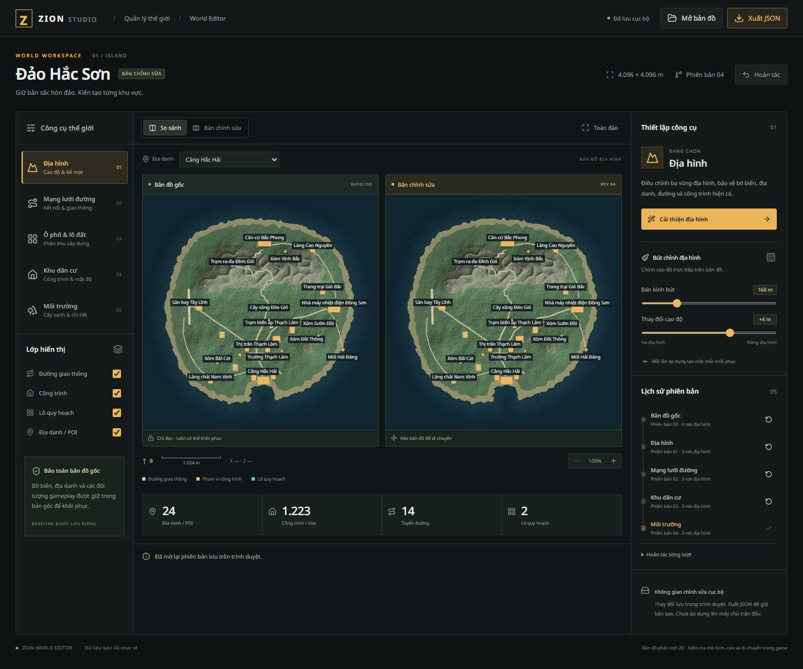

# Revision cải tạo Đảo: đã áp dụng một phần, chưa nghiệm thu toàn bộ

Revision này dùng dữ liệu Đảo hiện có và generator thực tế, đã lưu/tải lại, sinh chunk và kiểm tra bằng trình duyệt/physics. **Chưa kích hoạt cho trận Battle Royale, chưa hoàn tất tái quy hoạch đảo.** Road Pass Thạch Lâm không tìm được hành lang hợp lệ; không có ô phố thị trấn mới. Những mục chưa đạt được giữ rõ bên dưới.

## Baseline và bản sắc cần giữ

Map runtime hiện có metadata `red-island-03` / **Đảo Thung lũng Đỏ**, seed `zion-red-valley-02`, 128 chunk mỗi cạnh, 4.096 km. Map tác giả mà runtime thực sự gọi trong `authoredWorld` là `hac-son` / **Đảo Hắc Sơn**, ở `packages/worldgen/src/maps/island.ts`. Đây là khác biệt tên đã tồn tại trong code; không tạo map mới và không sửa tên/id/seed runtime để che khác biệt này.

Baseline gồm 32 đỉnh coastline, các đồi chủ đạo, rừng, 24 khu/POI, 14 tuyến đường, lưới điện và 1.221 site sinh ra từ bộ kit. Các vùng chính: cảng Hắc Hải và thị trấn Thạch Lâm ở phía nam/trung nam; căn cứ Bắc Phong ở bắc; sân bay Tây Lĩnh ở tây; nhà máy Đông Sơn ở đông; làng chài Nam Vịnh tây nam; cao nguyên và radar trên vùng cao phía bắc. Không di chuyển các anchor này, không đổi runway, cảng, đỉnh núi hoặc đường bờ.

- [Dữ liệu baseline](island-baseline.json): snapshot có thể mở trực tiếp bằng editor.
- [Manifest baseline](evidence/baseline-manifest.json): metadata gameplay, anchor, asset IDs và SHA-256 của structures/loot; hash source battle rules để đối chiếu build hiện tại.
- [Revision có đủ checkpoint](island-revision.json): baseline → terrain → roads → settlement → environment.

Phân loại đối tượng trước khi chỉnh: toàn bộ site/part, cửa, cầu thang, loot, cầu tàu, pylons và POI gốc thuộc nhóm **giữ nguyên**. Chưa có đối tượng gốc được đánh dấu cho phép di chuyển/thay thế vì chưa đủ audit liên kết gameplay. Nhóm được bổ sung là nhà, sân, rào và bụi cây ở lô mặt đường đã kiểm tra. Không xóa một khu gameplay nào.

## Khu vực thực sự đã thay đổi

| Khu / vị trí world (m) | Thay đổi đã ghi vào map | Thuật toán và phạm vi bảo vệ |
|---|---|---|
| Giữa sân bay Tây Lĩnh và đồng cỏ, tâm (1280, 2170) | Hạ địa hình cục bộ, radius 210 m, stroke -6 m | Sculpt delta smoothstep bình phương, culling theo vùng, mask bờ/đường/POI/site |
| Sườn nội địa phía đông nam dãy núi, tâm (2550, 1850) | Tạo vùng trũng chuyển tiếp, radius 260 m, stroke -8 m | Cùng mask; không thay đỉnh núi hoặc anchor; không gọi đây là mô phỏng erosion |
| Nội địa tây tuyến đèo chính, tâm (1700, 2100) | Gò chuyển tiếp, radius 220 m, stroke +5 m | Delta giới hạn ±12 m, giữ nguyên road routing/site levels nền |
| Làng chài Nam Vịnh, (1252.52, 3186.90) và (1111.49, 3166.91) | Hai lô mặt đường 18×18 m và hai nhà nhỏ asset 2404; polygon/frontage lưu cùng dữ liệu nhà | Đặt theo tiếp tuyến/pháp tuyến đường; asset bounds/collider thật; grade ≤12% tại probes; loại giao đường, gần site/dây điện/bờ; tối đa 2 nhà/khu |
| Hai sân nhà mới | Hàng rào ba phía, bụi cây, mặt đường để mở | Transform theo yaw nhà, dùng asset có sẵn, append sau site gốc để giữ gid và loot salts |

Các stroke bị mask có thể có delta thực thấp hơn thông số brush. Độ cao thay đổi tối đa đo được **7,9501 m**. Dải bờ được bảo vệ không đổi tại 66.049 điểm lấy mẫu cách 16 m trên toàn map. Có **1.549** điểm khác baseline, kể cả pads của nhà mới. Kiểm tra lấy mẫu không tương đương chứng minh hình học liên tục ở mọi tọa độ; mask và các test coast/POI bổ sung kiểm soát ràng buộc này.

**Thạch Lâm chưa thay đổi đường:** thử tám hành lang nối hai cross street hiện có. Bảy hành lang vướng corridor công trình khi tính cả mặt đường/shoulder; hành lang còn lại vượt grade 12%. Tất cả bị loại, 14 tuyến gốc được giữ. Bộ chia lô ô phố đã qua fixture khép kín, nhưng kết quả map thực là **0 block và 0 parcel thị trấn mới**. Hai lô Nam Vịnh là lô mặt đường nông thôn, không được đếm thành ô phố khép kín.

## Công cụ và rollback

World Studio có bố cục ba vùng: công cụ/lớp hiển thị, bản đồ và bảng thông số/lịch sử. Chuyển giữa so sánh hai bản và bản chỉnh sửa; kéo để di chuyển, dùng nút thu phóng hoặc chọn POI để xem từng khu vực. Các lớp đường, công trình, lô đất và nhãn địa danh bật/tắt độc lập; hai bản đồ dùng chung khung nhìn. Trên điện thoại, công cụ chuyển thành thanh ngang và các bảng xếp dọc. [Ảnh giao diện điện thoại](evidence/world-studio-mobile.png). Các điều khiển này chỉ thay đổi cách xem; bản gốc và định dạng JSON được giữ nguyên.

Mở `/studio/world` từ nút **World Editor** ở Studio. Trang đọc cùng `ISLAND`/`WorldGenerator` của game, có bản gốc bên trái và revision bên phải. Có Terrain Pass, sculpt tại tọa độ click, Road Pass, phân tích block/parcel, Settlement Pass nông thôn và Environment Pass. Giao diện 2D hiện dùng heightfield thật và overlay footprints; không phải viewer 3D gameplay với toàn bộ model.

Mở `island-revision.json` để xem phiên bản đã áp dụng. Editor kiểm tra schema, giới hạn dung lượng 4 MB, tối đa 64 checkpoint, yêu cầu baseline và các trường được bảo vệ khớp nguồn gốc. Lưu tự động vào browser storage, xuất/nhập JSON. JSON không tin cậy vẫn cần chạy lại generator/geometry validation trước khi kích hoạt; schema không thay kiểm tra gameplay.

**Khôi phục** một revision cắt lịch sử về checkpoint đó. **Hoàn tác riêng terrain/roads/settlement/environment** tạo revision mới, chỉ khôi phục nhóm dữ liệu của pass gần nhất, giữ các pass còn lại; cần kiểm chứng lại kết quả sau khi thay dependency. Chọn baseline để khôi phục toàn bộ. Khi không truyền `battleIsland`, generator tiếp tục dùng đảo gốc. Source data gốc không bị ghi đè; không có migration database/live world trong thay đổi này.

Tái lập từ thư mục gốc:

```powershell
pnpm --filter @zion/worldgen island:edit
pnpm test -- packages/worldgen/src/world-editor.test.ts packages/worldgen/src/battle-map.test.ts packages/worldgen/src/roads.test.ts
pnpm typecheck
pnpm --filter @zion/worldgen map:studio --mpp 8 --out ../../docs/world-editor/evidence/before.png
pnpm --filter @zion/worldgen map:studio --mpp 8 --document ../../docs/world-editor/island-revision.json --out ../../docs/world-editor/evidence/after.png
```

`island:edit` tái tạo preset revision/báo cáo tại `docs/world-editor`, không publish. `map:studio` chạy với cwd package nên đường dẫn output/document ở trên có `../../`. Để một server dùng revision sau nghiệm thu cần truyền `currentIsland(readIslandDocument(json))` vào `WorldGenerator` dưới trường `battleIsland`, đồng thời phân phối revision nhất quán cho mọi nơi sinh collision/chunk. Luồng upload/activation server và phân phối client này **chưa được xây dựng**; import file vào editor chưa làm thay đổi trận đấu.

## Bằng chứng và kết quả kiểm chứng

| Bằng chứng | Kết quả và giới hạn |
|---|---|
| [Validation dữ liệu thật](evidence/validation.json) | 1.221 site gốc giữ nguyên từng part/gid; sau bổ sung 1.223 site; loot spots/anchor giữ nguyên; 96 spawn được tìm; save/reload khớp |
| `world-editor.test.ts` | 4 test: schema/rollback, bảo toàn coastline/POI/loot/structures và roundtrip chunk, block/frontage fixture, đặt nhà thực + asset reference/collider + CharacterController tiến tới mặt nhà |
| `battle-map.test.ts`, `roads.test.ts` | 14 test hồi quy: determinism, đường/grade, render/collision/LOD, cửa, cầu thang và tháp; các kiểm tra cũ không đại diện một trận BR đầy đủ trên revision |
| [Browser validation](evidence/browser-validation.json) | Edge headless: file import → sculpt → rollback checkpoint → reload browser storage khớp JSON, hai canvas; không unhandled exception |
| Typecheck / lint | Workspace typecheck đã qua; ESLint chạy cho các file thay đổi. Không sửa các thay đổi BR/HUD có sẵn của phiên làm việc khác |
| [Ảnh editor thực tế](evidence/editor-browser.png) | Ảnh từ browser sau khi tải file revision thật; chưa phải góc nhìn gameplay |



| Góc nhìn | Trước | Sau |
|---|---|---|
| Toàn đảo | [PNG](evidence/before.png) | [PNG](evidence/after.png) |
| Địa hình vùng (2550, 1850), span 700 m, 2 m/px | [PNG](evidence/terrain-before.png) | [PNG](evidence/terrain-after.png) |
| Nam Vịnh, span 500 m, 1 m/px | [PNG](evidence/fishing-before.png) | [PNG](evidence/fishing-after.png) |

Các PNG bản đồ được render từ terrain/surface/props thật bằng Map Studio; footprint trong overlay là biểu diễn bản đồ, không phải ảnh model 3D. Terrain geometry thực sự thay đổi, không chỉ đổi màu. Sample Map Studio tổng thể 512×512 trước tối ưu khoảng 1,6 giây baseline; bản sculpt đầu khoảng 14,4 giây; culling stroke đưa về khoảng 2,9–3,2 giây trên máy này. Đây là timing chẩn đoán, không benchmark chuẩn; vẫn còn overhead ở vùng sculpt và chưa có cam kết FPS.

## Các tiêu chí chưa đạt và việc tiếp theo

- Chưa tái quy hoạch được đường/ô phố Thạch Lâm, cảng, công nghiệp hoặc căn cứ. Road planner hiện chỉ thử một tập corridor cố định, parcel town chỉ hỗ trợ hình chữ nhật; chưa có road growth/tensor/Voronoi/general planar-face extractor production. Cần kiểm tra ràng buộc rồi tạo đường tránh có grade/cut-fill phù hợp, phân loại cụ thể công trình được phép di chuyển thay vì nới collision tùy tiện.
- Chưa di chuyển/sắp xếp lại công trình gốc hoặc tạo mật độ khác nhau trên mọi khu. Hai nhà mới là additive; asset nhỏ có collider đặc, không phải nhà enterable với cửa hoạt động. Test đi tới mặt nhà chứng minh khả năng tiếp cận/va chạm, không chứng minh có thể vào trong. Cần dùng modular kit/asset có nội thất nếu khu vực yêu cầu enterable.
- Chưa có hydraulic/thermal erosion, terrain material blending mới, slope budget cho chuỗi brush chồng nhau hoặc môi trường toàn đảo. Các cải thiện hiện là sculpt có cấu trúc, giới hạn ba vùng và hai sân nhà.
- Chưa chạy trận BR end-to-end, lái xe giữa mọi vùng, xét mọi spawn/loot/POI/safe-circle state, hoặc visual review từ camera nhân vật. Không có tuyên bố gameplay toàn map đã được nghiệm thu chỉ từ invariant/physics tests.
- Chưa activation server/database migration, multiplayer revision sync, hoặc kiểm tra tải revision qua server live. Bản gốc vẫn là mặc định trận đấu.
- Chưa có browser worker cho raster/generation, undo stack nén theo diff, editor building/road handles tổng quát hoặc 3D preview. Import giới hạn và culling chỉ là bước đầu cho map lớn.

Nguồn, so sánh license/dependencies và lý do chọn thuật toán: [báo cáo nghiên cứu 9 repo](../procedural-world-research.md). Không đánh dấu mục 11 hoàn thành khi các tiêu chí trên còn thiếu.
